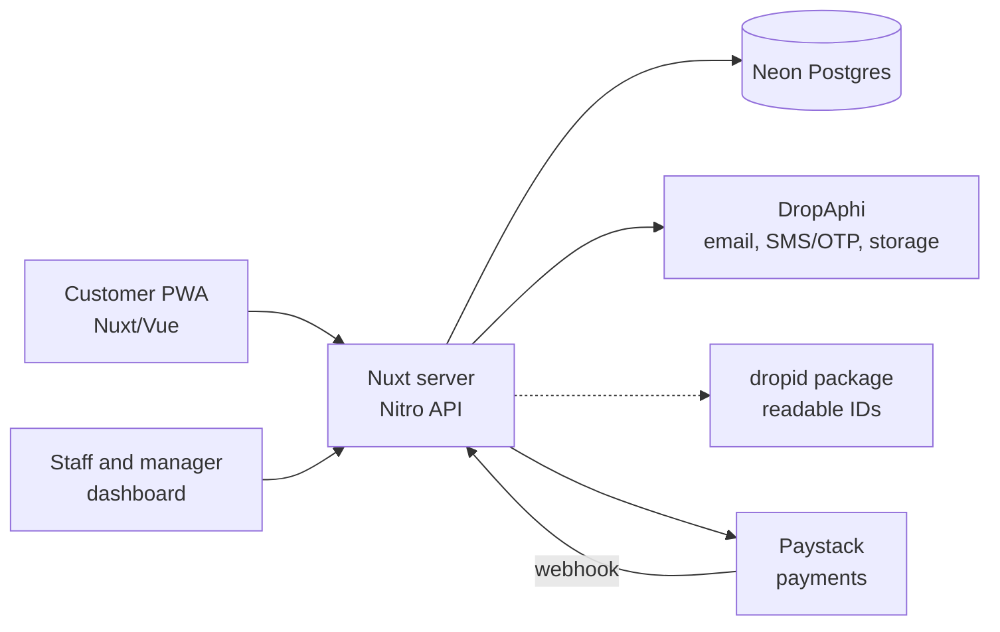
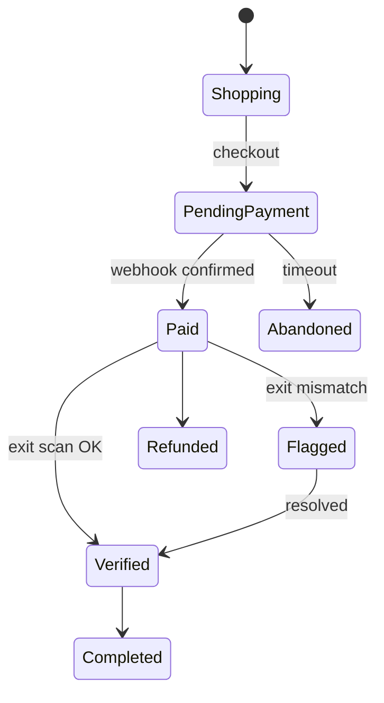

# stressless — Project Document

**Scan-and-go in-store shopping, as an installable web app (Nuxt + Vue, full stack)** Version 1.0 (MVP plan) · October 2026

---

## 1. Overview

stressless lets shoppers walk into a store, scan products with their phone, pay in the app, and leave without queuing. This MVP is a **web app (PWA)** that replaces the mobile app: customers can install it to their home screen, and store staff and managers use the same codebase through role-based dashboards.

**Problem:** checkout queues waste shoppers' time and tie up store staff. **Solution:** self-scan, in-app payment, and a quick exit verification.

## 2. Scope

**In the MVP**

- Customer sign-in (OTP), with unique, readable IDs on every record (DropID)
- Super Admin platform portal to onboard and manage store owners (multi-owner, multi-store)
- Store selection by QR code, shopping sessions
- Camera barcode scanning, cart, running total
- In-app payment, exit pass (QR), digital receipts
- Admin and store manager dashboard: stores, products, inventory, orders, staff, exit verification, spot checks, reports
- Installable PWA

**Out of the MVP (later)**

- Native mobile apps, loyalty and promotions, multi-currency, supplier and purchasing tools, smart-gate hardware integration

## 3. Users and roles

| Role | Can do |
| --- | --- |
| Customer | Sign in, scan, pay, view orders and receipts |
| Exit Staff | Scan exit passes, verify or flag orders |
| Store Manager | Manage products, stock, orders, spot checks, refunds, store staff, reports for their store |
| Store Owner | Owns one or more stores; manages their managers, staff and catalogue; sees reports for their own stores only |
| Super Admin | Platform level: creates, suspends and manages store owners and stores; sees platform-wide reports and settings |

## 4. User journeys

**Customer**

1. Open the website and tap **Start shopping**.
2. Sign in (email or phone OTP through DropAphi).
3. Scan the store's entrance QR code to start a shopping session.
4. Scan product barcodes; each scan adds the item to the cart with a live total.
5. Review the cart and pay.
6. Show the **exit pass QR** at the exit; staff verify it.
7. Receive the receipt by email, and see it in order history.

**Exit staff:** open the Exit screen, scan the customer's QR, see the cart and paid status, then tap **Verify** or **Flag**.

**Store manager:** manage the catalogue and stock, watch live orders, review flagged orders, run spot checks, issue refunds, read reports.

**Super Admin:** invite and onboard store owners, suspend or reactivate them, view all stores and platform-wide reports.

## 5. Functional requirements

**Customer app**

- FR-C1 Sign up and sign in with OTP; session persists on the device.
- FR-C2 Age-restricted items require the customer to confirm they are of age at checkout; staff check ID at the exit.
- FR-C3 Start a session by scanning a store QR code (or choosing from a list); a session belongs to one store and expires after inactivity.
- FR-C4 Scan barcodes with the camera, with manual entry as a fallback. Unknown barcodes show a clear message.
- FR-C5 Cart with quantity change, removal and a running total with tax.
- FR-C6 Pay in-app; payment status is confirmed by a server-side webhook, never by the browser.
- FR-C7 Exit pass QR, valid only for a paid order at that store, single-use.
- FR-C8 Order history and receipts.

**Admin and store manager**

- FR-A1 Stores: create and edit (Owner or Super Admin), hours, tax rate, entrance QR generation.
- FR-A2 Products: barcode, name, price, category, image, stock, active flag; CSV import.
- FR-A3 Orders: list, filter, detail, status, refund and void.
- FR-A4 Exit verification screen for staff.
- FR-A5 Random spot-check prompts with outcomes recorded.
- FR-A6 Inventory decreases on payment, with low-stock alerts.
- FR-A7 Staff accounts and roles.
- FR-A8 Reports: sales, top products, flagged orders, verification rates.
- FR-A9 Notifications (email and in-dashboard) for flagged orders and low stock.

**Platform (Super Admin)**

- FR-P1 Create, edit, suspend and reactivate store owners (invite by email through DropAphi).
- FR-P2 View all stores, orders and platform-wide reports.
- FR-P3 Platform settings, plus a read-only support view of an owner's dashboard (audit-logged).
- FR-P4 Owners are isolated: every query is scoped by owner.

## 6. Architecture



- One Nuxt application: Vue pages for the UI and Nitro server routes for the API.
- All third-party keys stay on the server. The browser only talks to our own `/api` routes.
- The server is the source of truth for prices, stock and payment status.

## 7. Technology stack

| Layer | Choice |
| --- | --- |
| Framework | Nuxt 3, Vue 3, TypeScript |
| UI | Tailwind CSS, Nuxt UI, `@vite-pwa/nuxt` (installable PWA) |
| State | Pinia |
| Scanning | Native `BarcodeDetector` with a ZXing fallback (iOS Safari) |
| Database | Neon (serverless Postgres) with Drizzle ORM and migrations |
| Validation | Zod (shared between client and server) |
| Auth | Server sessions (`nuxt-auth-utils`), OTP delivered by DropAphi |
| IDs | `dropid` npm package (readable prefixed IDs such as `order_a3f2b9c1d4e5`) |
| Email, SMS, files | DropAphi |
| Payments | Paystack (assumed) |
| Tests | Vitest, Playwright |
| Hosting | Managed Node host with Neon branches for staging and production |

## 8. DropAphi and DropID

A single server module, `server/services/dropaphi.ts`, wraps every call so the rest of the app never touches the SDK directly.

| Capability | Used for |
| --- | --- |
| Email | Receipts, flagged-order and low-stock alerts, staff invites |
| SMS/OTP | Sign-in codes |
| File storage | Product images, store logos, CSV imports |

Rules: calls run server-side only; failures are retried and logged in `order_events`; a failed email never blocks checkout.

**DropID** is a library, not a service: `pnpm add dropid`, then `dropid('order')` returns an ID like `order_a3f2b9c1d4e5` (nanoid-based, cryptographically secure). Every table's primary key uses it through one helper, `server/utils/id.ts` (for example `user_…`, `store_…`, `product_…`, `order_…`). IDs are readable in logs, QR codes and support tickets, and are always generated on the server.

*Exact DropAphi SDK methods will be confirmed against its docs during Phase 1.*

## 9. Data model

| Table | Key fields |
| --- | --- |
| `users` | id, name, email, phone, role (`super_admin`, `owner`, `manager`, `exit_staff`, `customer`), status, created_at |
| `owner_accounts` | id, user_id, business_name, status (`active`, `suspended`), created_by (Super Admin) |
| `stores` | id, owner_id, name, address, tax_rate, hours, qr_token, active |
| `store_staff` | user_id, store_id, role |
| `categories` | id, name |
| `products` | id, owner_id, barcode (unique per owner), name, price, category_id, image_file, age_restricted, active |
| `inventory` | store_id, product_id, quantity, low_stock_threshold |
| `shopping_sessions` | id, user_id, store_id, status, started_at, last_active_at |
| `cart_items` | session_id, product_id, quantity |
| `orders` | id, session_id, user_id, store_id, subtotal, tax, total, status, exit_token, created_at |
| `order_items` | order_id, product_id, name, unit_price, quantity |
| `payments` | order_id, provider_ref, amount, status, paid_at |
| `exit_verifications` | order_id, staff_id, result, note, at |
| `audits` | order_id, staff_id, outcome, note, at |
| `notifications` | id, user_id, type, body, read |
| `order_events` | order_id, type, detail, at (audit trail) |

## 10. Order lifecycle



## 11. API outline

| Method | Route | Purpose | Access |
| --- | --- | --- | --- |
| POST | `/api/auth/otp/request`, `/verify` | Sign in | Public |
| POST | `/api/sessions` | Start session from store QR | Customer |
| POST | `/api/cart/scan` | Add item by barcode | Customer |
| PATCH/DELETE | `/api/cart/items/:id` | Change or remove item | Customer |
| POST | `/api/checkout` | Create order, start payment | Customer |
| POST | `/api/webhooks/paystack` | Confirm payment | Provider (signed) |
| GET | `/api/orders`, `/api/orders/:id` | History, receipt | Customer |
| POST | `/api/exit/verify` | Verify exit pass | Exit Staff |
| CRUD | `/api/admin/stores`, `/products`, `/inventory`, `/staff` | Management | Manager/Admin |
| POST | `/api/admin/orders/:id/refund` | Refund | Manager/Admin |
| GET | `/api/admin/reports/*` | Reports | Manager/Owner |
| CRUD | `/api/platform/owners`, `/stores`, `/reports` | Onboard, suspend and manage owners and stores | Super Admin |

## 12. Pages

**Customer:** `/` landing, `/sign-in`, `/store/[token]`, `/scan`, `/cart`, `/pay`, `/exit-pass/[orderId]`, `/orders`. **Staff and admin:** `/admin`, `/admin/stores`, `/admin/products`, `/admin/inventory`, `/admin/orders`, `/admin/exit`, `/admin/audits`, `/admin/staff`, `/admin/reports`. **Super Admin:** `/platform`, `/platform/owners`, `/platform/stores`, `/platform/reports`, `/platform/settings`.

## 13. Security and fraud controls

- Prices, totals and stock are always recalculated on the server.
- Payment is confirmed only by a signature-verified, idempotent webhook.
- Exit tokens are random, single-use and tied to one paid order and one store.
- Role checks on every admin route; all inputs validated with Zod.
- Rate limiting on OTP, scan and checkout endpoints.
- Random spot checks and flagged-order review reduce theft.
- Secrets in environment variables only; HTTPS everywhere.
- Data is scoped by owner on every query, so one owner can never see another's stores, products or orders.
- Super Admin actions (creating or suspending owners) are audit-logged; suspending an owner blocks their stores.
- Audit trail for refunds, flags and price changes.

## 14. Non-functional requirements

- Scan-to-cart response under 1 second on a typical mobile connection.
- Works on current Chrome and Safari (Android and iOS), camera permission handled gracefully.
- Cart survives a page refresh and a short connection drop.
- Daily database backups, error monitoring, structured logs.
- Accessible, large tap targets, mobile-first layout.

## 15. Project structure

```
stressless/
├─ app/                  # Vue pages, components, composables, stores
│  ├─ pages/
│  ├─ components/
│  └─ composables/useScanner.ts
├─ server/
│  ├─ api/               # route handlers
│  ├─ services/          # dropaphi.ts, payments.ts, pricing.ts
│  ├─ db/                # schema.ts, migrations, seed.ts
│  └─ utils/             # auth, validation, rate limit, id.ts (dropid)
├─ shared/               # zod schemas and types
├─ tests/
├─ .env.example
├─ nuxt.config.ts
└─ package.json
```

## 16. Environment variables

```
APP_URL=http://localhost:3000
DATABASE_URL=<Neon pooled connection string>
DATABASE_URL_UNPOOLED=<Neon direct connection string, for migrations>
NUXT_SESSION_PASSWORD=<32+ character secret>
DROPAPHI_API_KEY=<from DropAphi>
PAYSTACK_SECRET_KEY=<sk_...>
PAYSTACK_PUBLIC_KEY=<pk_...>
SUPER_ADMIN_EMAIL=<your email, used by the seed>
```

*Exact DropAphi variable names will follow its SDK docs.*

## 17. Installation and setup

**Prerequisites:** Node 20+, pnpm, and a Neon project (the free tier is enough to start).

```bash
git clone <repo-url> stressless && cd stressless
pnpm install
cp .env.example .env        # fill in the values
pnpm db:migrate             # create tables
pnpm db:seed                # creates the Super Admin, a demo owner, store and products
pnpm dev                    # http://localhost:3000
```

- **Camera on a real phone** needs HTTPS: run `pnpm dev --https` or use a tunnel.
- **Tests:** `pnpm test` (unit) and `pnpm test:e2e` (Playwright).
- **Production:** `pnpm build`, then run the Nitro output on your host and run `pnpm db:migrate` on deploy. Register the Paystack webhook URL `APP_URL/api/webhooks/paystack`.

**Installing the app as a customer:** open the site on a phone, then use *Add to Home Screen* (Safari) or *Install app* (Chrome). It then opens full-screen like a native app.

## 18. Testing

- Unit: pricing, tax, stock decrement, order state machine.
- Integration: checkout with a mocked Paystack, webhook idempotency, DropAphi failure handling.
- End to end: sign in, verify ID, scan, pay, exit verification, refund.
- Manual: scanning on low-end Android and iPhone Safari under store lighting.

## 19. Delivery plan

| Phase | Deliverable |
| --- | --- |
| 1. Foundation | Project setup, Neon database, DropID id helper, auth and roles (Super Admin, Owner, Manager, Exit Staff, Customer), DropAphi service layer |
| 2. Platform and admin core | Super Admin portal (owners, stores), then products, inventory, CSV import |
| 3. Customer app | Store QR, scanner, cart |
| 4. Checkout | Paystack, webhooks, order states, exit pass |
| 5. Staff tools | Exit verification, spot checks, refunds, flagged orders |
| 6. Release | Reports, notifications, PWA polish, testing, deployment |

## 20. Assumptions and open items

- DropID is the `dropid` ID generator (checked on npm and GitHub). Its README mixes import names (`dropid`, `dropapi`, `dropaphi`), so the exact import path is confirmed on install.
- Multi-tenant: owners are isolated from each other; only the Super Admin sees everything.
- Without ID verification, age checks rely on a checkout confirmation plus staff checking ID at the exit.
- Paystack is the payment provider; Stripe could replace it.
- Exit verification by staff is part of the MVP flow.
- Tax is a single per-store rate.
- To confirm: restricted-item rules, refund policy, and whether stores share one product catalogue or each have their own.